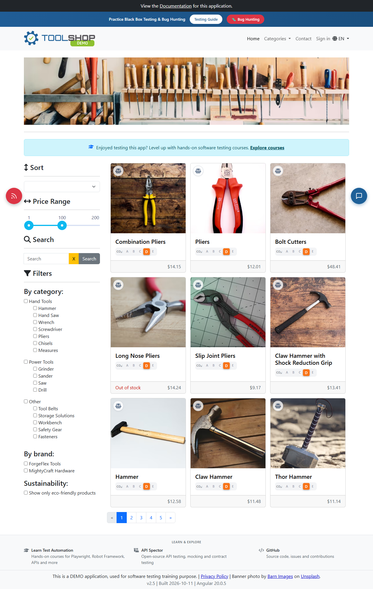

# Toolshop • Playwright + TypeScript

A portfolio automation project exercising the real [Practice Software Testing](https://practicesoftwaretesting.com/) demo through Chromium, Firefox, WebKit and its [documented API](https://api.practicesoftwaretesting.com/api/documentation).

The project combines business-focused page objects, reusable components, typed fixtures, unique test data, API setup, real UI/API comparisons and complete shopping journeys. Playwright provides isolated contexts, web-first assertions, request inspection, tracing and native HTML reporting; TypeScript catches mismatched contracts and fixture usage before execution.

<details>
<summary>Actual public catalog captured during Phase 0</summary>



</details>

**Execution evidence:** read [the actual run summary](docs/execution-summary.md). Browser configuration is not a claim that every scenario passed on every engine. The explicitly labeled mock test is not backend integration evidence.

## Stack and structure

Node.js 24 LTS, Playwright Test 1.64.1, strict TypeScript 5.9, APIRequestContext, dotenv, ESLint, Prettier, Playwright HTML/JSON reporters, Allure Playwright and GitHub Actions. Dependency versions are locked in package-lock.json.

```text
.github/workflows/playwright.yml   bounded Chromium/API smoke CI
src/api/{clients,helpers,models}   documented API and in-memory auth state
src/components/                   header, navigation and product cards
src/data/{factories,testData.ts}   unique synthetic accounts and scenario data
src/fixtures/                     base and authenticated test fixtures
src/pages/                        catalog, login, registration, product, cart,
                                  checkout, account and contact page objects
src/utils/config.ts               validated environment configuration
tests/{ui,api,integration,e2e}/    61 scenario definitions
docs/                             architecture, strategy, coverage, results
evidence/                         sanitized execution statistics
playwright.config.ts              projects, diagnostics and reporters
```

The catalog is the homepage; a redundant HomePage class is intentionally absent. There are no empty placeholder classes, generic base-page inheritance or shared mutable account fixtures. See the [architecture diagram](docs/architecture.md), [test strategy](docs/test-strategy.md) and [coverage matrix](docs/test-coverage.md).

## Install and configure

Use Node.js 24 LTS and npm. Commands below run from this project directory:

```bash
npm ci
npx playwright install
```

Linux CI needs browser system dependencies: `npx playwright install --with-deps`.

Copy `.env.example` to `.env` if overriding defaults. The default URLs already point to the hosted demo. WORKERS defaults to 1 and is capped at 2 to limit shared-environment load. RETRIES defaults to 0 locally and 1 in CI. Optional CHROMIUM_CHANNEL selects a normally installed Chrome channel; no stealth options are used. REPORT_DIR, RESULTS_DIR, JSON_REPORT and ALLURE_RESULTS_DIR allow separate run artifacts.

No secrets or account credentials are required. UUID user emails use example.com and synthetic addresses. Do not substitute personal details. The application is never installed or hosted locally by this project.

## Run

```bash
npm run typecheck
npm run lint
npm run format:check
npm run test:smoke -- --project=chromium
npm run test:regression -- --project=chromium --project=api
npm run test:serial
npm run test:parallel
npm run test:smoke:parallel
npm run test:api
npm run test:chromium
npm run test:firefox
npm run test:webkit
npm run test:headed -- --project=chromium --grep '@smoke'
npm test
```

`npm test` executes all configured projects (53 browser scenarios per engine plus eight API scenarios); prefer bounded smoke for routine public-demo checks. `test:smoke` without a project selects smoke across all projects. `test:regression` selects the full suite. Add `--grep SCENARIO-ID` for focused debugging.

Tags: `@smoke` critical checks, `@regression` full coverage, `@upload` contact file selection, and `@mock` the isolated network-interception example. Exclude mocking with `--grep-invert '@mock'` when measuring real backend checks.

To validate modest parallel execution:

```bash
npm run test:smoke -- --project=chromium --workers=2
npm run test:parallel
npm run test:smoke:parallel
```

Every test uses independent contexts and data. The config validates WORKERS; CLI overrides must still respect the public-demo limit of two. Do not start concurrent full-suite jobs.

`test:serial` runs the complete Chromium/API suite with one worker; `test:parallel` runs the same suite with two. `test:smoke:parallel` runs the eleven critical Chromium/API smoke checks with two. The full regression retains application-defect assertions; a passing smoke run must not be described as 100% regression success. See [hosted application remediation](docs/hosted-application-blockers.md) for changes that require the application owner's access.

## API-assisted testing

ToolshopApi uses Playwright APIRequestContext for documented product queries, user registration/login, profile reads and cart cleanup. Product IDs, brands, categories and prices come from live data. API tests verify response media types, identity, price relationships, authorization, registration and owned-cart quantity updates.

The real integration scenario fetches a product through the API, searches and opens it in the UI, compares its unit price, adds quantity two, checks the displayed total, then reads the same cart through the API and verifies product ID and quantity. E2E tests also read persisted invoices after simulated Cash on Delivery orders. Valid address fixtures use the documented postcode lookup because this demo validates against its synthetic locality rather than a real-world city.

Authenticated tests create an account and token per test and inject in-memory storageState. Login tests still use the UI. A separate two-user context test verifies account isolation. Cart persistence is tab session storage; authentication is local storage. Never commit storage state or tokens.

## Reports and diagnostics

```bash
npm run report
npm run allure:generate
npm run allure:open
```

The native report is generated automatically at `playwright-report/index.html`, with counts, duration, test titles, projects, errors and attachments. Failures retain screenshots and videos. The first retry records a trace; use `--retries=1` when investigating. Open a trace with `npx playwright show-trace path/to/trace.zip`.

Allure raw results are created automatically under `allure-results/`. Generating the Allure HTML report uses allure-commandline and requires a working Java runtime. The Allure reporter itself does not require Java. Report generation does not change test outcomes.

Reports, traces, videos, tokens and .env are ignored by Git. Even synthetic reports can contain generated credentials in form snapshots or request traces: review artifacts before sharing. Sanitized summaries and overview screenshots are intended for Git. Local generated reports are supplied for review, not as files to commit.

## GitHub Actions

Push and pull-request runs install Node 24, `npm ci`, Chromium and system dependencies, then typecheck, lint and run the small Chromium/API smoke set with one worker. A manual input enables Chromium/API regression. Reports and diagnostics upload with `if: always()` and seven-day retention. Test failures retain the failing job status; there is no `continue-on-error`. There is no scheduled public-environment traffic.

The public demo needs no secrets. For a separately authorized environment, supply sensitive values through GitHub Actions secrets rather than committed .env files. The workflow is provided and locally checked; hosted GitHub execution requires pushing the repository.

## Test-data lifecycle and limitations

Owned carts and favorites are cleaned up using supported endpoints. Customer accounts cannot delete themselves through the documented API, and submitted demo invoices have no customer delete operation. They remain until the shared demo resets. Tests do not use admin endpoints, seeded accounts, real financial data or bulk cleanup.

The site may reset or change data and enforce rate limits. Anonymous `/users/me` returns 401 and is captured in diagnostics. API and UI validation rules may differ; see documented findings. No separate shipping selection or native browser dialog exists in the inspected shopping flow. Contact file selection verifies a zero-byte .txt payload and clearing through setInputFiles; it does not submit a contact message or prove server-side upload. Download success is stated only if a genuine invoice PDF was obtained during execution.

## Troubleshooting and future work

- Missing browser executable: run `npx playwright install` with the same user/environment used for execution.
- DNS or connection failure: verify ordinary network access. Do not bypass CAPTCHA, bot detection or access restrictions.
- Product lookup fails: inspect the live API and report before updating expectations; demo resets change IDs.
- A failed web-first assertion: inspect the HTML error context, screenshot and browser diagnostics; use a retry trace for request timing.
- Allure generator cannot start: verify `java -version` and JAVA_HOME. Native HTML reporting remains independent.

Future enhancements include approved dedicated-environment account cleanup, runtime schema validation against a pinned OpenAPI contract, accessibility checks, and broader cross-browser regression after a stable baseline. These are not represented as implemented coverage.
